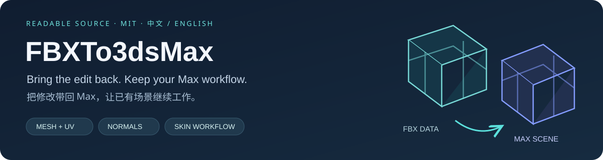
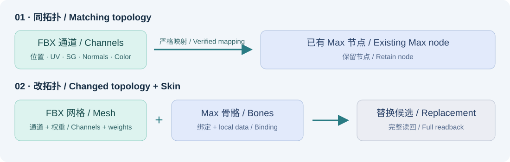
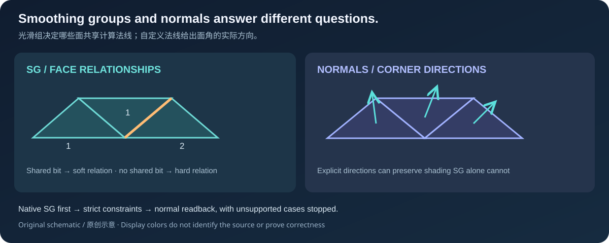

# FBXTo3dsMax

### 在别处修改模型，回到 Max 继续工作。
### Edit elsewhere. Continue in your existing Max scene.

把 FBX 的形状、UV、材质、顶点色和法线带回 **3ds Max**：同拓扑按通道更新；拓扑改变后，通过 Skin、骨骼与绑定检查再替换网格。

Bring FBX shape, UVs, materials, vertex data and normals back into **3ds Max**. Update selected channels on matching topology, or replace a changed mesh after Skin, bone and binding validation.

**Dimmens · 免费可读源码 / Free readable source · MIT · 中文 / English**

**[固定 v1.4.26 / Fixed v1.4.26](https://github.com/DimmensCK/FBXTo3dsMax/archive/refs/tags/v1.4.26.zip)** · **[最新图文源码 / Latest illustrated source](https://github.com/DimmensCK/FBXTo3dsMax/archive/refs/heads/main.zip)** · [Release](https://github.com/DimmensCK/FBXTo3dsMax/releases/tag/v1.4.26) · [中文教程](docs/zh/FBXTo3dsMax_详细说明书.md) · [English tutorial](docs/en/USER_GUIDE.md)

[安装 / Start](#quick-start) · [界面 / UI](#language-ui) · [模式 / Modes](#workflows) · [形状 / Shape](#shape) · [UV](#uv) · [材质 / Materials](#materials) · [RGB & Alpha](#vertex-data) · [光滑组 / SG](#smoothing) · [法线 / Normals](#normals) · [Skin](#skin) · [原创练习 / Exercise](#exercise) · [实测范围 / Testing](#scope)

## 三步开始 / Three steps to start

1. **完整下载、解压。** 保留根目录安装器和小写 `contents/` 等目录，不在 ZIP 内运行。 
   **Download and extract the complete package.** Keep the installer and all folders together.
2. **保存场景，拖入安装器。** 将 **`Install_FBXTo3dsMax.ms`** 拖进 Max 视口，确认安装成功。 
   **Save your scene and drag the installer into a Max viewport.** Confirm the installation result.
3. **打开、自检、试副本。** 点击顶部 **FBX 转 MAX / FBX to MAX**，选中文或 EN，运行自检，首次用副本中的单对象。 
   **Open the toolbar entry, choose your language and run Self-check.** Start with one object in a scene copy.

使用 Max 自带 Python，通常无需额外解释器、编译器或管理员权限。安装失败先解决，再开始使用。卸载入口为 `Uninstall_FBXTo3dsMax.ms`。

Uses Max's bundled Python; an extra interpreter, compiler or administrator access is normally unnecessary. Resolve installation errors before use. Remove with `Uninstall_FBXTo3dsMax.ms`.

[中文安装、重装与卸载](docs/zh/INSTALL_中文.md) · [English installation, reinstall and removal](docs/en/INSTALL.md)

## 中文 / English，原位切换 / Switch in place

| 中文 | English |
|---|---|
|  |  |

点击模式标题右侧的 **Language · 中文 / EN**，保留模式、文件、选项和检查状态；再次点击当前语言仍保持单选，选择会保存供下次使用。已知界面与报告标签支持中英切换，原始技术诊断可能保留原文。

Use **Language · 中文 / EN** beside the mode heading. Switching retains the mode, file, options and check state; clicking the active language keeps it selected. Your preference is saved. Known UI/report labels are localized; original technical diagnostics may retain their source text.

上图是较早 1.4.26 源码在 Max 2023.3.10 中的真实界面参考，展示布局；当前核心的实测范围另见 [TESTING](docs/TESTING.md)。 
These are actual UI references from an earlier 1.4.26 source in Max 2023.3.10. They illustrate layout; see [TESTING](docs/TESTING.md) for separate core qualification.

## 先选工作流 / Choose your workflow

**数据方向始终是 FBX → Max 接收网格。先选 Max 网格，再选 FBX。** 界面的“Max 源模型”接收数据，“FBX 目标模型”提供数据。

**Data always flows from FBX to the receiving Max mesh. Select the Max mesh first, then the FBX.** The Chinese source/target labels do not reverse this direction.

| 任务 / Task | 模式 / Mode | 前提与结果 / Requirements and result |
|---|---|---|
| 形状、UV、材质、RGB/Alpha、SG/法线 / Shape, UVs, materials, RGB/alpha, SG/normals | **模式一：模型完全一致 / 传递数据** · **Matching Models / Transfer Data** | 保留 Max 节点，写入勾选通道。须保持顶点身份、连接与绕序，并有唯一面映射。 / Keep the Max node; update selected channels. Vertex identity, connectivity, winding and unique face mapping must match. |
| 改拓扑后替换带 Skin 的网格 / Replace a skinned mesh after topology changes | **模式二：模型不一致 / 替换并保留蒙皮** · **Different Models / Replace / Keep Skin** | 双方各一个合格 Skin；使用 FBX 网格/权重和 Max 场景骨骼/绑定。 / One valid Skin on each side; use FBX mesh/weights with Max scene bones/binding. |

通用步骤：**选接收网格 → 选 FBX → 选模式与通道 → 检查 FBX/匹配 → 阅读报告 → 开始执行 → 核对结果**。一个网格对一个网格可直接配对，其余组合按完整网格名匹配。相同点数、面数不等于拓扑身份一致。

Shared steps: **select receiver → select FBX → choose mode/channels → Check FBX / Match → read report → Run Transfer → inspect result**. One-to-one meshes can pair directly; other combinations use full mesh names. Equal counts do not prove matching topology.

## 01 · 修改轮廓，保留 Max 节点 / Update shape, retain the Max node

| 授权历史示意：传递前 / Historical before | 传递后 / After |
|---|---|
|  |  |

**怎么做：** 保持拓扑身份，选模式一，先只勾默认的 **变形 / Shape**，检查后执行。此次不需要的通道不勾选。检查轮廓、原节点、修改器栈；带 Skin 时再检查动画。

**Try it:** preserve topology identity, choose Mode 1 and start with only the default **Shape** option. Check, then transfer. Leave unrelated channels unselected. Inspect the silhouette, original node and modifier stack; test animation when Skin is present.

这段约 10 秒的授权历史预览展示 **v1.3.23 模式一变形后的结果查看**，不是完整操作或模式二替换演示。历史对照图的左右位置不定义数据来源。 
This authorized, approximately 10-second **v1.3.23 Mode 1 result preview** is not a complete procedure or a Mode 2 replacement demonstration. Image placement does not define data authority.

[播放 MP4 / Play MP4](docs/assets/demos/mode1-deformation-v1.3.23.mp4) · [中文步骤](docs/zh/FBXTo3dsMax_详细说明书.md#任务一只修改形状) · [English steps](docs/en/USER_GUIDE.md#task-1--update-shape-only)

## 02 · 单独更新 UV 1 / 2 / 3 / Transfer UV channels independently

**怎么做：** 模式一中取消不需要的变形，只勾 FBX 实际包含的 **UV 1 / 2 / 3**。执行后，在 Unwrap UVW 中切到相应 map channel，检查岛、接缝与面角对应。图中展示的是通道 **2** 的历史检查。

**Try it:** in Mode 1, deselect Shape if positions should stay unchanged. Select the **UV 1 / 2 / 3** channels actually present in the FBX. After transfer, inspect the corresponding map channel in Unwrap UVW, including islands, seams and corner mapping. This historical image shows channel **2**.

UV 按面角映射，一个几何顶点可有多个 UV 顶点。通道缺失并跳过不代表复制成功。 
UVs use face-corner mapping; one geometric vertex can have several UV vertices. A missing, skipped channel has not been copied.

[中文步骤](docs/zh/FBXTo3dsMax_详细说明书.md#任务二更新-uv材质与面-id) · [English steps](docs/en/USER_GUIDE.md#task-2--update-uvs-materials-and-face-ids)

## 03 · 材质与逐面 ID 一起带回 / Bring back materials and face IDs

**怎么做：** 在模式一勾 **材质与 ID**，取消不需更新的变形及其他通道。检查、执行后查看材质槽，并选面核对实际 ID 与分配；只改 UV 时可以不传材质。

**Try it:** select **Material / ID** in Mode 1. Deselect **Shape** and other channels that should stay unchanged. After checking and transferring, inspect material slots and actual face assignments. A UV-only edit can leave materials untouched.

材质对象和逐面 ID 是两项都要核对的数据，视口颜色相近不能替代检查。 
Inspect both the material object and per-face IDs; similar viewport colors are insufficient.

[中文教程](docs/zh/FBXTo3dsMax_详细说明书.md#任务二更新-uv材质与面-id) · [English tutorial](docs/en/USER_GUIDE.md#task-2--update-uvs-materials-and-face-ids)

## 04 · RGB 与 Alpha 分别传递 / Transfer RGB and alpha separately

| RGB 顶点色 / Vertex color | 独立 Alpha / Independent alpha |
|---|---|
|  |  |

**怎么做：** 模式一分别勾 **RGB 顶点色** 和/或 **顶点 Alpha**。执行后使用对应顶点通道显示或材质检查，不需移动模型时取消变形。

**Try it:** select **RGB vertex color** and/or **vertex alpha** independently in Mode 1. Inspect the corresponding channel with a suitable viewport display or material. Deselect Shape if the mesh should not move.

RGB 是 **map channel 0**，独立 Alpha 是 **map channel -2**，不会从 RGB 亮度推测。缺失数据会警告并跳过；两幅图为授权历史通道检查。

RGB is **map channel 0**; independent alpha is **map channel -2**, never inferred from RGB brightness. Missing data is warned about and skipped. Both images are authorized historical inspections.

[中文步骤](docs/zh/FBXTo3dsMax_详细说明书.md#任务三分别传递-rgb-与-alpha) · [English steps](docs/en/USER_GUIDE.md#task-3--transfer-rgb-and-alpha-separately)

## 05 · 传回面之间的光滑关系 / Transfer smoothing relationships

**怎么做：** 只需平滑关系时勾 **光滑组 / Smoothing groups**。执行后用“按平滑组选择”与逐面掩码检查相邻面的关系。图中是历史 SG 选择检查，不是所有所选面都属于单一光滑组的证明。

**Try it:** choose **Smoothing groups** when only face smoothing relationships need updating. Inspect selection by smoothing group and per-face masks afterward. This historical selection view does not prove that all highlighted faces belong to one group.

优先采用有效 FBX 原生平滑层；需要推导时严格核对边和顶点扇关系，无法精确表达则停止。SG 不等于任意自定义法线方向。

A valid native FBX smoothing layer takes priority. Inferred relationships are checked strictly; unrepresentable constraints stop the operation. SG cannot encode every custom normal direction.

[中文教程](docs/zh/FBXTo3dsMax_详细说明书.md#任务四选择光滑组或自定义法线) · [English tutorial](docs/en/USER_GUIDE.md#task-4--choose-smoothing-groups-or-custom-normals)

## 06 · 保留自定义法线方向 / Preserve custom normal directions

**怎么做：** 勾 **顶点法线 / Vertex Normals**；若 SG 也要来自 FBX，两项一起勾选。执行后查看最终面角方向及修改器栈，保留插件创建的 **`F2M_顶点法线`**，不要删除或塌陷它。

**Try it:** select **Vertex Normals** to transfer custom directions. Select SG too when both should come from FBX. Inspect final corner directions and the stack afterward; retain the generated **`F2M_顶点法线`** modifier without deleting or collapsing it.

绿色、蓝色等显示颜色表示编辑/选择状态，不能判断方向来自 SG 还是 FBX。用户自己的 Edit Normals / Weighted Normal 不会被静默清除；覆盖冲突会停止。

Display colors indicate editing/selection state, not whether a direction came from SG or FBX. User Edit Normals / Weighted Normal modifiers are not silently removed; overriding conflicts stop the transfer.

[中文步骤与三路行为](docs/zh/FBXTo3dsMax_详细说明书.md#任务四选择光滑组或自定义法线) · [English steps and transfer paths](docs/en/USER_GUIDE.md#task-4--choose-smoothing-groups-or-custom-normals)

## 07 · 拓扑改变后，结合 FBX 权重与 Max 骨架 / Changed topology: FBX weights, Max bones

**怎么做：** 在场景副本中，确认 Max 与 FBX 网格各有一个合格 Skin，骨骼能唯一匹配。选模式二，保留默认 **隐藏备份旧网格**，检查后执行。检查新网格、权重、绑定、位置与显示状态，再播放动画并保存重载。

**Try it:** on a scene copy, ensure each Max/FBX mesh has one valid Skin with uniquely matched bones. Choose Mode 2, keep the default **hidden old-mesh backup**, then check and transfer. Inspect the new mesh, weights, binding, placement and display; test animation and save/reload.

| 数据 / Data | 来源 / Authority |
|---|---|
| 新网格、通道、默认材质、逐顶点权重 / New mesh, channels, default material, per-vertex weights | **FBX** |
| 场景骨骼身份、绑定 local data、包络 / Scene bone identity, binding local data, envelopes | **Max** |
| 候选 Mesh Bind / Candidate Mesh Bind | 在候选上自适应建立并验证 / Adapted and validated for the candidate |

这是原创流程示意，没有可公开的完整历史模式二录像。模式二不会自动迁移旧父子层级、Transform/动画控制器、约束或任意修改器，不承诺任意改拓扑后完整动画系统无损。多对象须保留备份；单对象关闭备份后存在不可逆删除边界。

This is an original workflow schematic; no complete historical Mode 2 recording is available for publication. Old parenting, transform/animation controllers, constraints and arbitrary modifiers do not migrate automatically. Arbitrary topology edits are not a promise of lossless animation-system cloning. Batches require backups; single-object replacement without backup crosses an irreversible deletion boundary.

[中文完整步骤](docs/zh/FBXTo3dsMax_详细说明书.md#任务五拓扑改变后替换带-skin-的网格) · [English full workflow](docs/en/USER_GUIDE.md#task-5--replace-a-skinned-mesh-after-topology-changes)

## 08 · 不用下载模型，试做原创雨棚 / Try an original canopy without downloading models

| 实际传递前 / Before actual transfer | 实际传递后 / After actual transfer |
|---|---|
|  |  |

[原创练习 / Original exercise](docs/examples/README.md)现场生成接收网格与编辑后的 FBX。选择模式一，勾变形与 UV1，先检查，再执行并比较结果。生成器负责准备数据，插件负责实际传递。

The [original exercise](docs/examples/README.md) generates a receiving mesh and edited FBX locally. Choose Mode 1 with Shape and UV1, check, then transfer and inspect. The generator prepares data; the plugin performs the transfer.

两张 **960×640** 原生渲染来自 1.4.26 同一次真实安装副本运行，同相机、棋盘材质与灯光，展示 **91 顶点、144 三角形**雨棚的形状与 UV1 更新。保留了接收节点、材质与选择。它们是实际结果图；上方历史截图和原创概念图分别标注。

These **960×640** native renders belong to one actual 1.4.26 installed-copy run, with the same camera, checker material and lighting. They show Shape/UV1 updates on an original **91-vertex, 144-triangle** canopy while retaining the receiver, material and selection. Historical images and conceptual schematics above are labeled separately.

[媒体来源、版本与授权 / Media provenance, versions and authorization](docs/assets/MEDIA.md)

## 读报告，再扩大操作 / Read the result before widening the operation

| 状态 / Status | 含义与下一步 / Meaning and next step |
|---|---|
| 检查通过 / Check passed | 可以继续执行，还未完成传递。 / Ready to proceed; transfer has not happened. |
| 所选通道缺失并跳过 / Selected channel missing and skipped | 没有复制该通道，先修正 FBX。 / That channel was not copied; correct the FBX. |
| 执行完成 / Transfer completed | 核对实际通道、外观、动画与保存重载。 / Inspect channels, appearance, animation and save/reload. |
| 失败或恢复不完整 / Failure or incomplete recovery | 保留副本与报告，解决后再扩大操作。 / Retain the copy/report and resolve it before proceeding. |

模式一按对象执行事务，后续失败不会自动撤销先前成功对象。模式二保留备份时支持批次回滚。正式传递同步执行，没有中途安全取消；自检是独立、可取消的 Batch 任务。

Mode 1 uses per-object transactions; a later failure does not undo earlier successful objects. Mode 2 supports batch rollback with backups. Transfer is synchronous and has no safe mid-operation cancellation; Self-check is a separate cancellable Batch task.

报告位于 `%LOCALAPPDATA%\FBXTo3dsMax`；安装日志/归档位于 `%APPDATA%\Autodesk\FBXTo3dsMaxInstaller`。公开反馈前去掉路径、模型名与项目资料。

Reports are under `%LOCALAPPDATA%\FBXTo3dsMax`; installation logs/archives are under `%APPDATA%\Autodesk\FBXTo3dsMaxInstaller`. Remove paths, model names and project information before public feedback.

## 实测范围 / Tested scope

**1.4.26 · Windows 11 x64 · 3ds Max 2023.3.10 · bundled Python 3.9.7**

2026-10-11 图文包已完成 **337/337 纯回归、32 项静态安装资源检查、中文六类安装自检、9 个原生故障场景、16 例独立世界点回归与原创雨棚实际传递**。新的隔离五步链及独立证据复核通过：全新/重复安装、冷启动、安装副本自检、真实安装失败回滚与正常重试、可恢复卸载；各阶段自然退出 0，无强制清理。准确冻结来源、最后文档覆盖与历史结果见 [TESTING](docs/TESTING.md)；CI 不运行 Max。

The 2026-10-11 illustrated package completed **337/337 pure tests, 32 static installation resources, six Chinese installed checks, nine native fault cases, 16 independent world-point cases and the original canopy transfer**. Its new isolated five-stage chain passed independent evidence review: fresh/repeat install, cold start, installed checks, actual installer-failure rollback with normal retry, and recoverable uninstall. Every stage exited naturally with code 0 and no forced cleanup. See [TESTING](docs/TESTING.md) for the frozen host source, final documentation overlay and historical results. CI does not run Max.

**Max 2024–2026 尚未实测；复杂资产、全部故障、性能、27→32 跨版本升级及卸载归档复装未获完整覆盖。** 历史双语/英文/PowerShell 结果保留各自范围。小型回归不能保证未知缺陷为零，归档哈希完整不等于复装演练通过。

**Max 2024–2026 remain unverified. Complex assets, all faults, performance, the historical 27→32 upgrade and restoration from uninstall archives are not fully covered.** Historical bilingual/English/PowerShell results retain their own scope. Small regressions cannot establish zero unknown defects; archive hashes do not prove exercised restoration.

## 源码与维护 / Source and maintenance

仓库提供可读 Python / MAXScript、安装器、测试、双语教程与授权媒体，**不分发私有 FBX / MAX / BLEND、原内部 PDF、备份或日志**。上方固定发行版是可重复下载的插件版本；[main ZIP](https://github.com/DimmensCK/FBXTo3dsMax/archive/refs/heads/main.zip) 是后续开发与文档快照。

The repository contains readable Python/MAXScript, installers, tests, bilingual guides and authorized media, **without private FBX/MAX/BLEND models, original internal PDFs, backups or logs**. The tagged download is a fixed plugin release; [main ZIP](https://github.com/DimmensCK/FBXTo3dsMax/archive/refs/heads/main.zip) is the evolving development/documentation snapshot.

[Issues](https://github.com/DimmensCK/FBXTo3dsMax/issues) · [贡献 / Contributing](docs/development/CONTRIBUTING.md) · [GitHub 下载与更新 / Download and maintain](docs/GITHUB_发布指南.md) · [更新日志 / Changelog](docs/development/CHANGELOG_中文.md)

Copyright © 2026 **Dimmens** · [MIT License](LICENSE). 免费使用、修改、商用与再分发，须保留版权和许可证。媒体授权不包含底层私有模型权利；Autodesk 3ds Max 需另行取得。 
Free use, modification, commercial use and redistribution with copyright/license retained. Media authorization grants no rights to underlying private models. Autodesk 3ds Max is obtained separately.
