[English](README.md) | **简体中文**

> **English readers:** The plug-in and complete guides are available in English. [Read the English homepage →](README.md)

# FBXTo3dsMax

### 更新模型，继续用你搭好的 Max 场景。

免费开源的 **FBX → Autodesk 3ds Max** 插件：**按需更新网格通道、传递自定义法线，或替换带 Skin 的新网格**。

- **这次改什么，就带回什么；同拓扑保留原接收节点。** 形状、UV 1/2/3、材质/ID、RGB 与 Alpha 分别选择，写回已有 Max 网格。
- **光滑组与精修法线一起带回。** 传递软硬关系与自定义面角方向，严格检查并读回最终法线结果。
- **新 FBX 网格、新权重，继续用 Max 场景骨骼。** Skin、骨骼与绑定通过检查后替换，默认隐藏备份旧网格。

**[下载带更新教程的 v1.4.26 完整工程](https://github.com/DimmensCK/FBXTo3dsMax/releases/tag/v1.4.26)** · **[先看完整演示](#demos)** · [三步开始](#quick-start) · [完整教程](docs/zh/FBXTo3dsMax_详细说明书.md)

Dimmens · MIT · 可读 Python / MAXScript 源码 · 已实测 **3ds Max 2023.3.10**

[两种模式](#workflows) · [形状](#shape) · [UV](#uv) · [材质](#materials) · [RGB 与 Alpha](#colors) · [光滑组](#smoothing) · [法线](#normals) · [Skin](#skin) · [安装](#quick-start) · [中文 / English 界面](#language-ui)

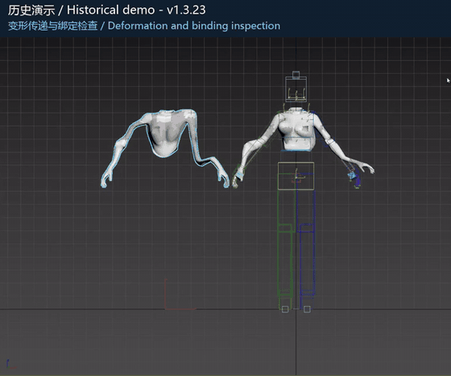

*历史 v1.3.23 模式一结果检查；下方可看完整流程。*

## 先看作者怎么用

这段作者的历史 **v1.3.23 模式一完整录像**展示了实际流程：选择 FBX、检查匹配、勾选多项通道、执行、阅读法线与缺失通道提示，再检查结果并旋转已有骨骼。

**完整操作录像 · 60.43 秒**

[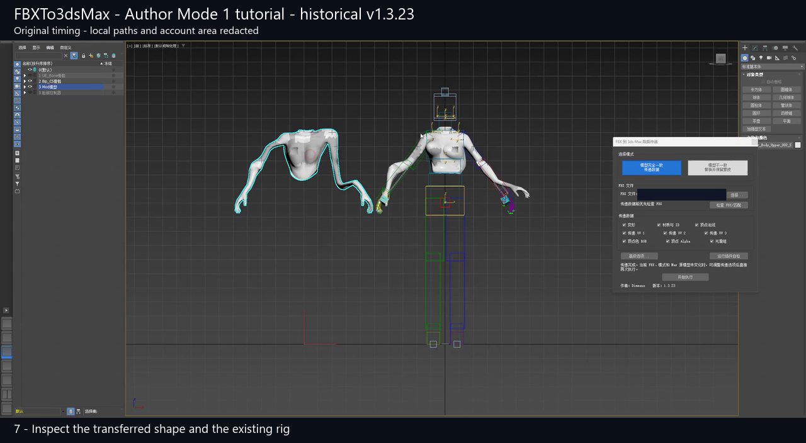](https://github.com/DimmensCK/FBXTo3dsMax/raw/refs/heads/main/docs/assets/demos/mode1-author-full-v1.3.23.mp4)

**[打开 / 下载完整 MP4](https://github.com/DimmensCK/FBXTo3dsMax/raw/refs/heads/main/docs/assets/demos/mode1-author-full-v1.3.23.mp4)**

**精简导览 · 28.93 秒 · 缩短等待段**

**[打开 / 下载精简导览 MP4](https://github.com/DimmensCK/FBXTo3dsMax/raw/refs/heads/main/docs/assets/demos/mode1-author-guide-v1.3.23.mp4)**

点击封面或链接打开 / 下载 MP4，具体行为由浏览器决定。最新 [main ZIP](https://github.com/DimmensCK/FBXTo3dsMax/archive/refs/heads/main.zip) 内也包含[完整录像](docs/assets/demos/mode1-author-full-v1.3.23.mp4)与[精简导览](docs/assets/demos/mode1-author-guide-v1.3.23.mp4)。

| 完整录像的位置 | 可以重点看什么 |
|---|---|
| 约 0:00 | 选择 FBX，运行预检 |
| 约 0:17 | 勾选要带回的数据并开始执行 |
| 约 0:46 | 法线差异说明，以及 UV3 缺失后跳过的提醒 |
| 约 0:49 | 查看新形状与法线修改器，再旋转已有骨骼 |

两个版本来自同一段作者历史录像，都保留了关键提示；当前界面可能略有不同。[媒体来源与版本](docs/assets/MEDIA.md)。

## 两种模式，覆盖两类返修

**数据方向始终是 FBX → Max 接收网格。** 先选 Max 网格，再选 FBX。

| 这次改了什么 | 选择模式 | 插件怎么做 |
|---|---|---|
| 同拓扑的形状、UV、材质、顶点数据或着色 | **模型完全一致 / 传递数据** | 保留 Max 接收节点，只写勾选通道 |
| 网格拓扑与 Skin 权重 | **模型不一致 / 替换并保留蒙皮** | 采用新 FBX 网格与权重，结合 Max 场景骨骼和绑定数据 |

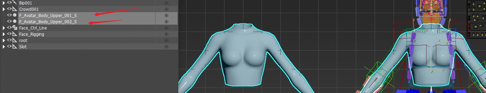

Max 和 FBX 各一个网格时可直接配对，其余数量组合按完整网格名匹配。上图只展示 Max 侧多选，不代表已核对 FBX 名称。模式一要求顶点身份、连接、绕序与唯一面映射成立；点数、面数一样，并不足以证明同拓扑。

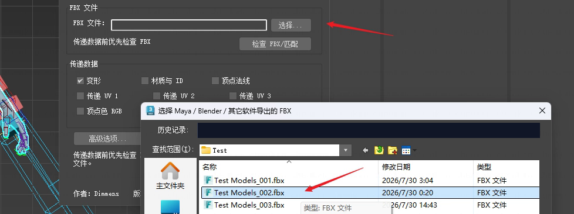

选好 Max 接收网格后，使用插件的文件选择按钮，找到提供本次修改数据的 FBX。

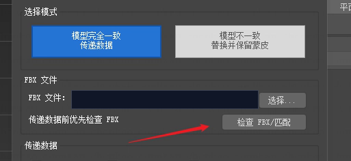

**先检查，再执行：** 用 **检查 FBX/匹配** 阅读匹配对象与提醒，再开始传递。预检通过时，还没有写入所选数据。

## 形状：更新轮廓，保留 Max 节点

比例、轮廓和点位修改可以带回原接收网格，不必替换该 Max 节点。适用于保留拓扑身份的形状返修。

| 作者历史示例：传递前 | 传递后 |
|---|---|
| 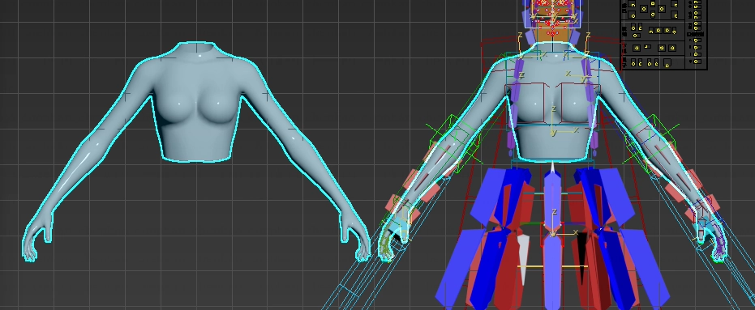 | 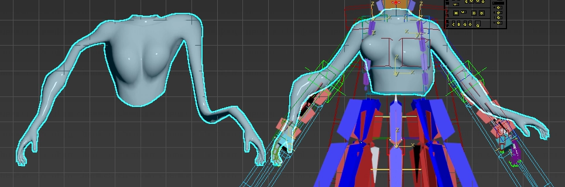 |

**照着做：** 模式一 → 先只勾默认的 **变形** → **检查 FBX/匹配** → **开始执行**。核对形状和原节点；带 Skin 时再在副本上检查动画。不需要改的通道保持未勾选。

[形状操作教程](docs/zh/FBXTo3dsMax_详细说明书.md#任务一只修改形状)

## UV：只返修 UV，不再改点位

**UV 1 / 2 / 3** 可以分别传递。按面角建立对应关系，保留几何顶点与 UV 接缝顶点之间的区别。

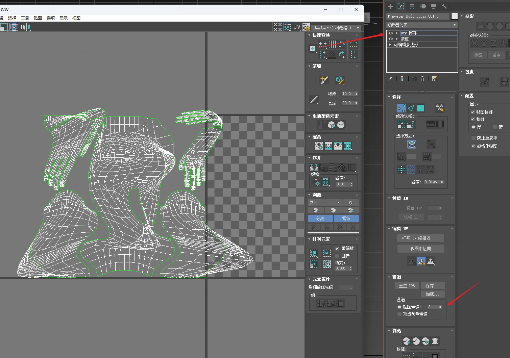

**照着做：** 取消 **变形** → 勾选 FBX 实际具有的 UV 通道 → 检查并执行。在测试副本中用 **Unwrap UVW** 切到对应贴图通道，核对 UV 岛、接缝与棋盘拉伸。作者这张图展示通道 **2**；查看 UV1/3 时分别切到通道 1/3。

缺失通道会报告并跳过。完整录像保留了 UV3 缺失提示，方便你区分“操作完成”和“某个通道没有复制”。

[UV 操作教程](docs/zh/FBXTo3dsMax_详细说明书.md#任务二更新-uv材质与面-id)

## 材质：材质与逐面 ID 一起带回

更新材质对象与逐面材质 ID，同时自己决定点位和其他通道是否需要改变。

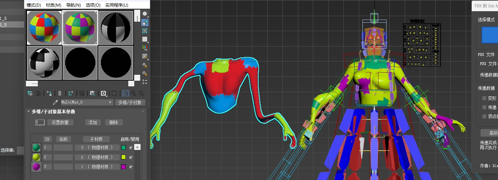

**照着做：** 勾 **材质与 ID**，取消不相关通道 → 检查并执行 → 核对材质槽和实际逐面 ID。只改 UV 时，可以保留原材质。

[材质与面 ID 教程](docs/zh/FBXTo3dsMax_详细说明书.md#任务二更新-uv材质与面-id)

## 顶点数据：RGB 与 Alpha 各传各的

RGB 颜色与独立 Alpha 遮罩分别勾选，需要哪项就带回哪项。

| RGB 顶点色 | 独立顶点 Alpha |
|---|---|
| 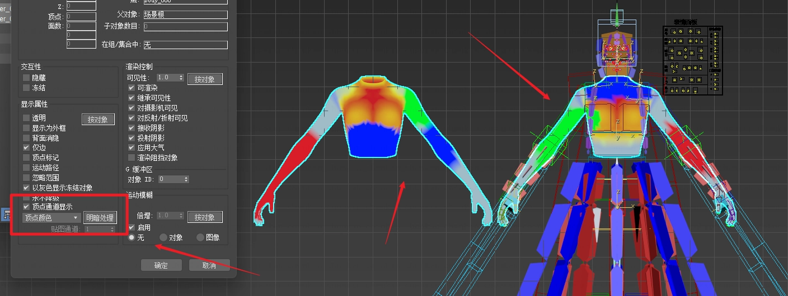 | 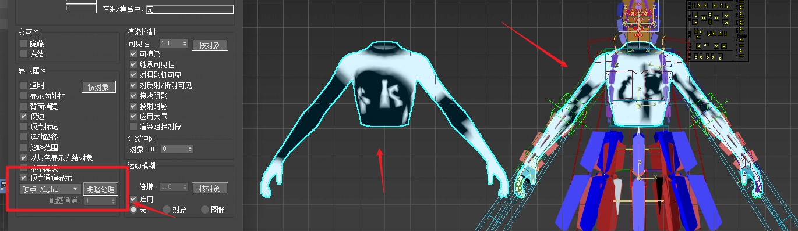 |

**照着做：** 分别勾 **顶点色 RGB** 和/或 **顶点 Alpha** → 检查并执行 → 用对应视口显示或材质查看实际通道。RGB 是 **map channel 0**；独立 Alpha 是 **map channel -2**，不会由 RGB 亮度推算。

[顶点数据教程](docs/zh/FBXTo3dsMax_详细说明书.md#任务三分别传递-rgb-与-alpha)

## 光滑组：把面之间的软硬关系带回来

优先使用有效的 FBX 原生平滑层；需要推导时，严格求解器按照 Max 的 **32 位光滑掩码**验证软硬边与顶点扇关系。无法支持或无法精确表达的关系会停止传递。

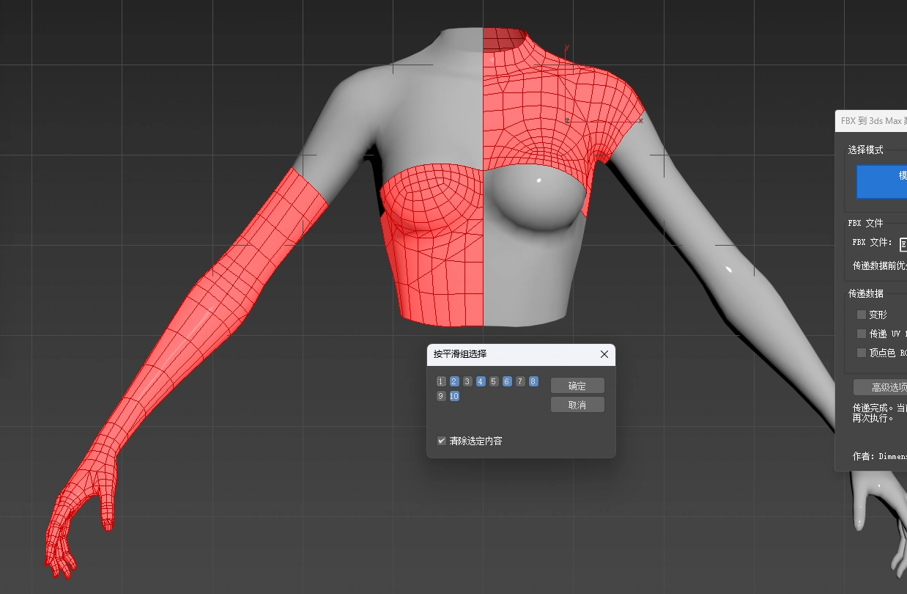

**照着做：** 勾 **光滑组** → 检查并执行 → 在测试副本中查看逐面掩码，并使用 **按平滑组选择**。当编辑过的方向包含 SG 表达不了的信息时，同时传自定义法线。

[光滑组教程与约束](docs/zh/FBXTo3dsMax_详细说明书.md#任务四选择光滑组或自定义法线)

## 自定义法线：保留你认真编辑过的方向

将 FBX 自定义面角方向带回，并与光滑组配合使用。SG 感知路径保留超过平滑基线 **0.1°** 的自定义差异；写入和重新求值后都会核对最终方向。

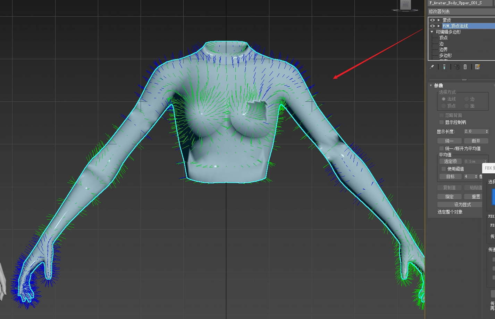

| 你要的结果 | 勾选 |
|---|---|
| 只更新面平滑关系 | **光滑组** |
| 保留 Max 接收模型的 SG，带回自定义方向 | **顶点法线** |
| SG 与自定义法线都来自 FBX | **光滑组 + 顶点法线** |

**照着做：** 选择相应组合 → 检查并执行 → 查看结果，保留 **`F2M_顶点法线`**。这个生成的修改器是结果的一部分，不能删除或塌陷。发现用户自己的 **Edit Normals / Weighted Normal** 覆盖冲突时会停止，不会静默删掉它们。

作者完整录像展示了法线差异说明与结果对比。方向线颜色表示编辑或选择状态；评估结果要看实际方向和报告。

[法线传递路径与教程](docs/zh/FBXTo3dsMax_详细说明书.md#任务四选择光滑组或自定义法线)

## 改拓扑后：新 FBX 权重，继续用 Max 场景骨骼

模式二将新 FBX 网格及逐顶点权重，接入已有 Max Skin 的场景骨骼与绑定数据。支持处理 FBX 顶点的 **Unnormalized** 与 **DQ** 状态，提交前后都会读回验证候选结果。

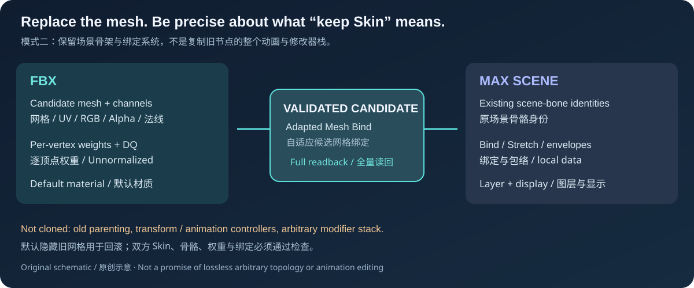

*这是原创流程示意，不是软件截图或替换操作录像。*

| 最终数据 | 来源 |
|---|---|
| 新网格、通道、默认材质、逐顶点权重 | **FBX** |
| 场景骨骼身份、Bone Bind/Stretch、包络与 Skin local data | **Max Skin** |
| 候选 Mesh Bind | 为新候选自适应建立的绑定 |

**照着做：** 保存场景副本 → 确认双方各有 **一个合格 Skin**，所需骨骼唯一匹配 → 选模式二 → 保留 **替换时隐藏备份旧网格** → 检查并执行。核对权重变形、世界位置与隐藏旧备份，再播放动画、保存重开。

候选继承旧 Max 图层与节点显示状态。保留备份时支持批次回滚，多对象替换必须启用备份。旧父子层级、Transform/动画控制器、约束和任意用户修改器不会自动迁移。单对象关闭备份后，删除旧节点属于不可逆边界。

上方录像展示的是 **模式一**；作者素材没有完整模式二录像。[模式二教程与数据合同](docs/zh/FBXTo3dsMax_详细说明书.md#任务五拓扑改变后替换带-skin-的网格)。

## 三步开始

1. **打开 [v1.4.26 发行页](https://github.com/DimmensCK/FBXTo3dsMax/releases/tag/v1.4.26)，下载页面顶部推荐的完整工程 ZIP，然后解压。** 保留安装器、小写 `contents/` 及其余目录。
2. **保存场景，将 `Install_FBXTo3dsMax.ms` 拖入 Max 视口。** 确认安装成功后再继续。
3. **从顶部 `FBX 转 MAX / FBX to MAX` 打开插件。** 选 **中文** 或 **EN**，运行自检，首次从场景副本中的单对象开始。

插件使用 Max 自带 Python，通常无需额外解释器、编译器或管理员权限。卸载入口为 `Uninstall_FBXTo3dsMax.ms`。

[安装、重复安装与卸载](docs/zh/INSTALL_中文.md) · [发行说明](https://github.com/DimmensCK/FBXTo3dsMax/releases/tag/v1.4.26)

### 插件内原位切换语言

| 中文界面 | English UI |
|---|---|
| [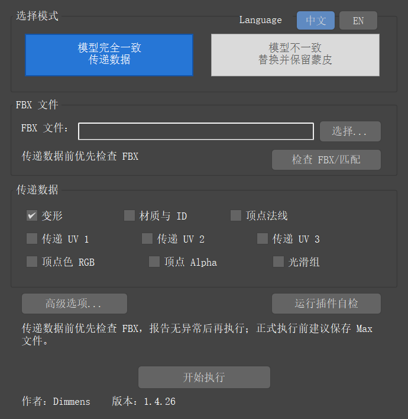](docs/assets/ui/rollout-1.4.26-cn.png) | [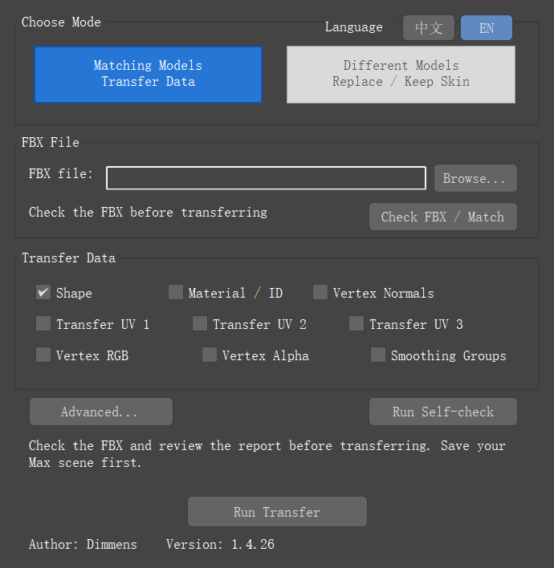](docs/assets/ui/rollout-1.4.26-en.png) |

模式标题右侧使用 **Language · 中文 / EN**，切换时保留模式、FBX、选项与检查状态，始终保持唯一语言选中并保存偏好。已知界面/报告标签跟随语言；原技术诊断可能保留原文。

两张均为 Max 2023.3.10 真实截图，展示较早的 1.4.26 布局。点击任意图片可查看原始尺寸。[媒体说明](docs/assets/MEDIA.md)。

## 继续阅读

- [完整任务教程](docs/zh/FBXTo3dsMax_详细说明书.md)：操作步骤、匹配、通道合同、Skin 数据来源与故障排查。
- [安装指南](docs/zh/INSTALL_中文.md)：完整包、重复安装、所有权检查、日志与卸载。
- [English homepage](README.md) 与 [English full tutorial](docs/en/USER_GUIDE.md)。
- [媒体说明](docs/assets/MEDIA.md)：作者截图/视频、历史版本与原创示意的来源。

### 先试一个原创练习

[雨棚练习](docs/examples/README.md)在本机生成接收网格和编辑后的 FBX。选 **模式一 + 变形 + UV1**，亲自检查并传递，不必下载模型。

| 原创雨棚：传递前 | 真实变形 + UV1 传递后 |
|---|---|
| 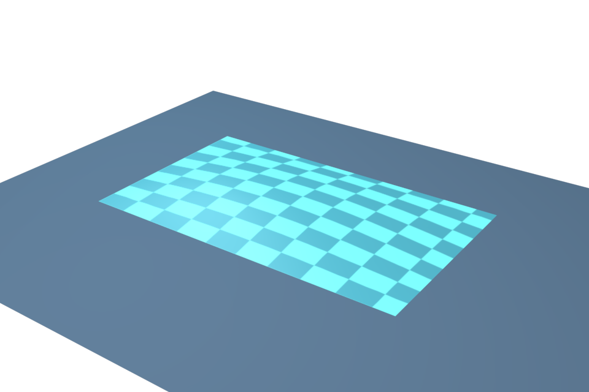 | 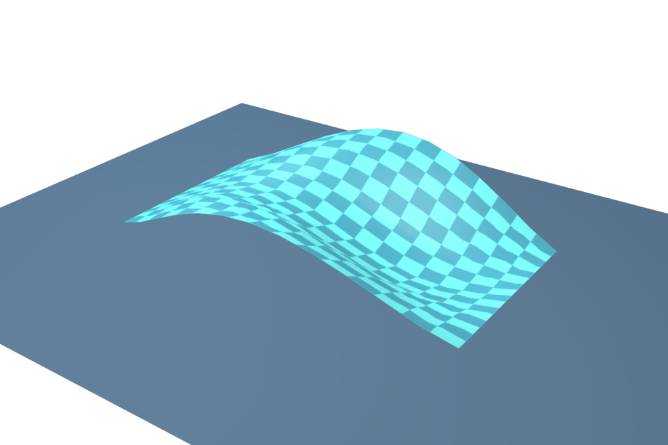 |

这是 Max 2023.3.10 中同一次 1.4.26 安装副本运行的原生渲染。原创网格为 **91 顶点、144 三角形**，两图使用同一相机、材质与灯光。具体范围见练习和媒体说明。

## 实测范围与场景保护

真实宿主验收使用 **Windows 11 x64、3ds Max 2023.3.10、内置 Python 3.9.7**。文档记录的来源通过 **337 项纯回归**、中文六类安装自检、9 个原生故障场景、16 例独立世界点回归，以及隔离安装/回滚/卸载链。[TESTING](docs/TESTING.md)保留准确来源与限制；CI 不运行 Max。本轮主页只改安装运行资源之外的展示内容。

**Max 2024–2026 尚未验证。** 小型原创测试不覆盖所有复杂骨架、大资产性能或未知缺陷。卸载归档已核对哈希，但尚未演练从归档复装。

先检查，再执行，最后阅读结果并核对场景副本。模式一按对象执行事务，后续对象失败不会撤销先前已成功对象；模式二保留备份时支持批次回滚。名称、选择、导入器设置及临时节点都有恢复/读回护栏。正式传递同步执行，没有中途安全取消。

## 反馈、源码与许可证

仓库提供可读 **Python / MAXScript**、安装器、测试与教程。首次安装请使用 [v1.4.26 发行页](https://github.com/DimmensCK/FBXTo3dsMax/releases/tag/v1.4.26)顶部推荐的完整工程 ZIP；下方自动生成的 **Assets → Source code** ZIP 是原标签快照。[main ZIP](https://github.com/DimmensCK/FBXTo3dsMax/archive/refs/heads/main.zip)随分支变化，适合开发查看。

遇到可复现问题，请在 [Issues](https://github.com/DimmensCK/FBXTo3dsMax/issues)提供 Max/插件版本和去隐私步骤。公开日志前去掉本机路径、模型名与项目信息，不上传私有资产。

[贡献](docs/development/CONTRIBUTING.md) · [更新日志](docs/development/CHANGELOG_中文.md) · [GitHub 下载与维护指南](docs/GITHUB_发布指南.md)

Copyright © 2026 **Dimmens** · [MIT](LICENSE)。免费使用、修改、商用与再分发需保留版权和许可证。教程媒体授权不包含底层私有模型权利；仓库不分发私有 FBX/MAX/BLEND 模型文件。Autodesk 3ds Max 需另行取得。
